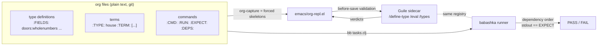

# org-repl

**Org for truth, Emacs for forced structure, Guile for semantics, babashka
for orchestration.** No Logseq, no second app — one org file format, one
type registry, one compose file.

## The process



**Roles, non-negotiable:** org holds the data, Emacs forces the structure,
the sidecar owns semantics, bb only orchestrates commands. bb never
evaluates types; elisp never runs commands.

## The model (unchanged from the primitives up)

- `characters`, `wholenumbers`, `symbols` — the three primitives.
- Types are data: `(define-type house (doors wholenumbers)
  (windows wholenumbers) (address streetname))`.
- Terms are values: `house (2 5 Bahnhof 12)`.
- **One-direction composition:** a field's type must exist at definition
  time. No forward references, no self reference — the type graph is a DAG,
  and journal order is dependency order.

## The dictionary: references, not copies

`types/dictionary.tsv` is the single source of truth (dict.cc format:
German<TAB>English). Two reference types exist beside the primitives:

- `german` — valid iff the word is a German entry in the dictionary
- `english` — valid iff the word is an English entry

`streetname` = `word:german` + `number:wholenumbers`. A streetname term
`["Bahnhof", "12"]` is a *reference* to the dictionary entry, not a copy
of it. Change the entry once, every term that references it sees the new
value. Unknown words are refused at eval time: `expected german, got x`.

## The buttons

`C-c r` opens the transient menu (Emacs ≥ 28, `transient` is built in):

- `t` — new type (forced fields)
- `m` — new term of a type
- `c` — new command (RUN/EXPECT)
- `v` — validate buffer

Same functions as the `M-x org-repl-capture-*` commands, just one key away.

## Run it

```sh
docker compose up --build
```

## Test it (all three layers)

**1. The sidecar:**

```sh
curl -X POST localhost:3000/eval \
  -d '{"type":"house","term":["2","5",["Bahnhof","12"]]}'
# ⇒ {"status":"ok","rendered":"2 5 Bahnhof 12"}

curl -X POST localhost:3000/eval \
  -d '{"type":"house","term":["2","5",["Bahnhof","x"]]}'
# ⇒ {"status":"invalid","errors":["expected wholenumbers, got x"]}

curl -X POST localhost:3000/define-type -d '{
  "name":"house2","fields":[{"name":"address","type":"house2"}]}'
# ⇒ self reference refused
```

**2. Babashka runs the commands:**

```sh
docker compose run --rm bb bb tasks.clj notes/commands.org
```

Expected:

```
PASS streetname
PASS build-house
FAIL bad-house
  expected: 2 5 Bahnhof 12
  got:      2 5 Bahnhof x
```

`bad-house` is deliberately broken so you can see a FAIL. Commands run in
`:DEPS:` order; cycles are refused.

**3. Emacs:**

```elisp
;; in the emacs container or your own Emacs:
(load-file "/opt/org-repl.el")     ; or the repo path
(org-repl-mode)
;; C-c r                          → the buttons menu
;; M-x org-repl-capture-type      → forced type skeleton
;; M-x org-repl-capture-term      → forced term skeleton
;; M-x org-repl-capture-command   → forced command skeleton
;; saving an org buffer validates every type and term in it
```

## Files

- `scm/term/types.scm` — the semantics, pure, commented
- `scm/term/dictionary.scm` — the shared dictionary (entries, not copies)
- `scm/term/server.scm` — HTTP shell (owns all I/O)
- `types/bootstrap.scm` — seed vocabulary in dependency order
- `types/dictionary.tsv` — the shared dictionary (dict.cc format)
- `verify.scm` — 20 acceptance checks (`docker compose run --rm repl guile-3.0 -s verify.scm`)
- `emacs/org-repl.el` — forced skeletons + before-save validation + buttons
- `bb/tasks.clj` — the command runner (dependency order + EXPECT)
- `notes/` — example org files (a good house, a bad command)
